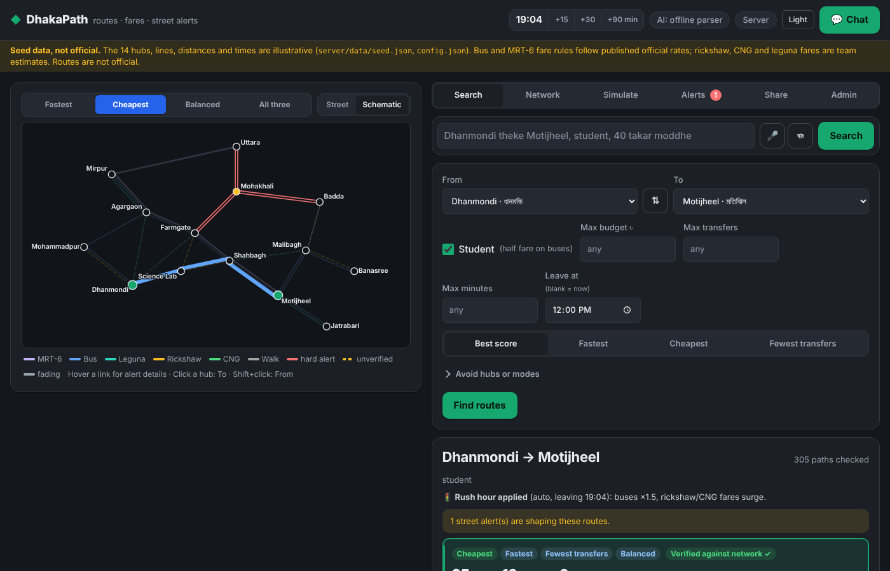
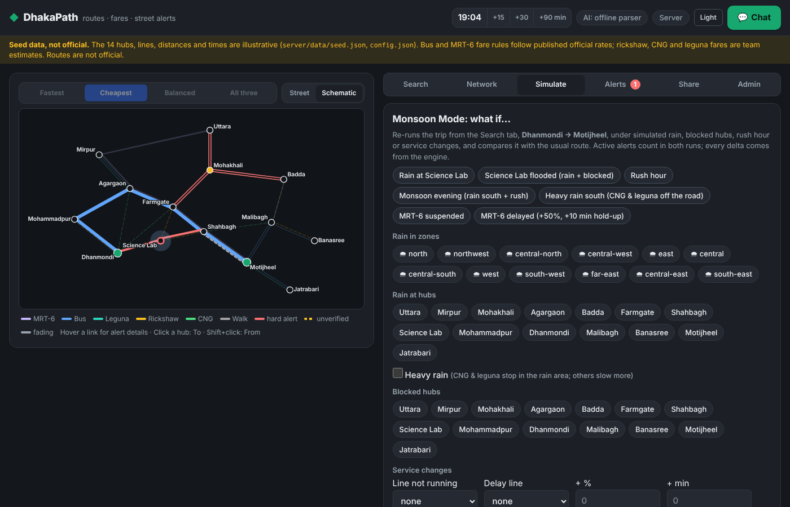
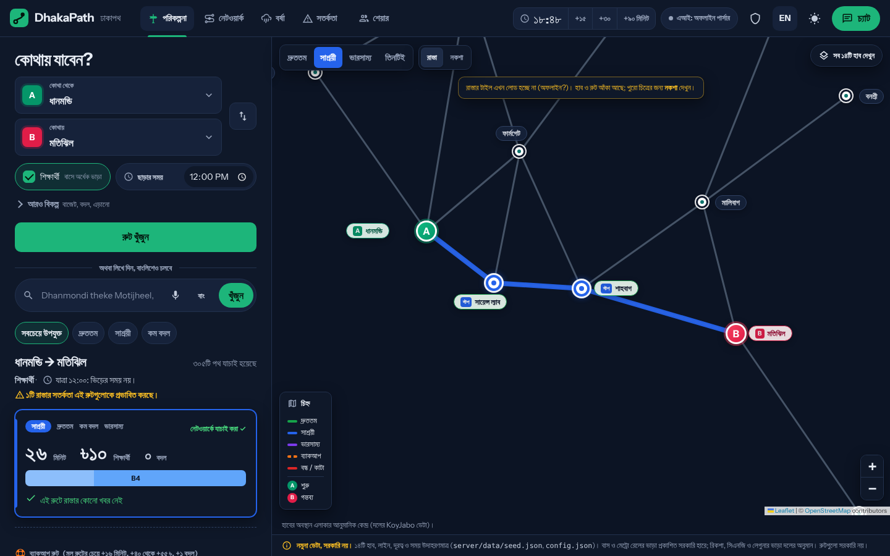
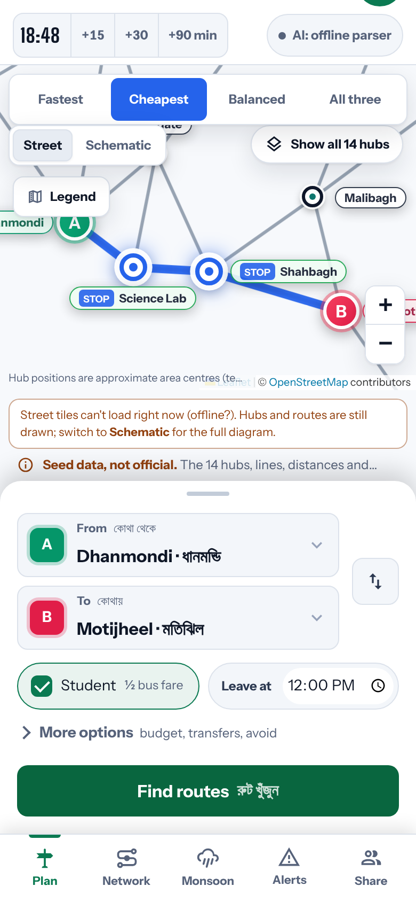

# DhakaPath

**Grounded route, fare and street-alert assistant for Dhaka commuters** — built for the INIF 2026 Smart City hackathon.

The network graph decides routes, fares and alert status; an optional AI layer only reads messages and phrases explanations. **If the AI is down or has no key, everything still works.** One Node.js process, no database, no build step, no required dependencies: `npm start` on a fresh clone is the whole setup.

| Plan: the map is the stage, routes are tickets | Monsoon Mode (before / after) |
|---|---|
|  |  |

| Full Bangla (বাংলা) with Bangla numerals | Phone, 390 px (light) |
|---|---|
|  |  |

*The build sandbox had no internet, so the street map shows hubs and routes without OpenStreetMap tiles (and a small offline note); with a connection the tiles load underneath.*

> **Seed data, not official.**
> - Hubs, lines, distances, times and landmark notes in `server/data/seed.json` are assumptions taken from the team's spec. Routes are not official and have not been verified on the ground.
> - **Bus and MRT-6 fare rules follow published official rates** (checked 16 Oct 2026; sources in `config.json → fares.*.source` and under every fare breakdown): city bus ৳2.70/km, minimum ৳10 (government gazette, effective 22 Sep 2026); MRT-6 ৳5/km, ৳20–100 (the official fare is a station-to-station chart, which the per-km rule approximates).
> - Rickshaw, CNG and leguna fares are **team estimates** (unmetered, negotiated), marked VERIFY in `config.json` and labelled "estimate" in the app.
> - Hub coordinates are approximate area centres. Landmark notes marked `sample` are placeholders.

## Quick start

Prerequisites: **Node.js 20 or later** (tested on 22.22.0). Nothing to install.

```bash
git clone <your-repo-url> dhakapath && cd dhakapath
npm start                      # http://localhost:3000
```

```bash
cp .env.example .env           # optional: AI keys, ADMIN_PASSWORD, PORT (never commit .env)
npm run dev                    # same as start, restarts on file changes (node --watch)
npm test                       # 96 automated tests, no browser needed
npm run reset                  # delete data/state.json -> next start uses seed.json + demo alerts
npm run preview                # one-file offline preview at dist/dhakapath-preview.html (needs python3)
```

If port 3000 is taken the server says so and tries the next free port; `PORT=3100 npm start` picks one yourself.

### Environment variables (`.env.example`)

| Variable | Default | Meaning |
|---|---|---|
| `PORT` | `3000` | HTTP port |
| `GEMINI_API_KEY`, `GEMINI_MODEL` | empty, `gemini-2.0-flash` | Optional AI provider (tried first). Without any key the rule parser answers and the header shows **AI: offline parser**. |
| `GROQ_API_KEY`, `GROQ_MODEL` | empty, `llama-3.1-8b-instant` | Optional backup AI provider |
| `AI_TIMEOUT_MS` | `4000` | Per-call AI timeout; after it the demo cache, then the rule parser, answer |
| `ADMIN_PASSWORD` | empty | Admin tab password. If empty, a one-time password is printed at start-up. |
| `STATE_FILE` | `data/state.json` | Where CMS edits, alerts, fare reports and watched trips are saved. `off` = memory only. |
| `CLOCK_SPEED` | `1` | Simulated clock speed (`0` = frozen until +15/+30/+90 is pressed) |
| `LOG` | empty | `off` silences request logs |
| `USE_EXPRESS` | empty | `1` runs the same routes on real Express after `npm install` (optional; see limitations) |

Secrets stay in `.env` on the server; nothing in the API or the UI echoes them. The browser sends a random anonymous id as `X-User-Id`; it de-duplicates votes and rate-limits, and is **not** a verified identity.

## The app (one UI at `/`)

Everything runs from `public/` (plain HTML, CSS and ES modules; Leaflet, two OFL fonts and an icon sprite vendored, so it works offline). The selection of this single frontend is recorded in [`docs/architecture/adr-001-single-frontend.md`](docs/architecture/adr-001-single-frontend.md); the "Night Route" design system and every panel are described in [`docs/UI-UX.md`](docs/UI-UX.md) and the redesign plan in [`docs/UI-REDESIGN-PLAN.md`](docs/UI-REDESIGN-PLAN.md).

**Layout.** On a desktop the map fills the screen and the planner is a panel on the left that scrolls on its own; sections (Plan, Network, Monsoon, Alerts, Share) sit in the header, Admin behind the shield button, chat in a drawer. On phones and tablets the map is on top with its controls laid over it, the planner slides up over it like a sheet, and the sections move to a bottom nav. **The map opens when you want it:** on phones it starts folded behind a *Show map* button; on desktop *Hide map* gives the planner the full width; the choice is remembered. **Drag to resize:** the planner's right edge on desktop, the sheet's handle on phones (arrow keys work too; double-click resets).

**English or Bangla.** The **বাং / EN** button switches the whole interface between full English and full Bangla, including Bangla numerals (২৬ মিনিট, ৳১০) and the network's own Bangla hub names, and remembers the choice per browser. `public/js/i18n.js` translates what is on screen (labels, the UI's messages and the engine's common sentences: directions, why lines, backup, fare verdicts, best time, Monsoon explanations, share bot); form values and API requests never change, chat replies and user posts stay as written, and switching back restores the exact English text.

- **Plan** — From / To fields carrying the map's A / B pins, Student and Leave-at always visible, budget / transfers / minutes / avoid / single mode under *More options*, a natural-language box (English, Banglish, Bangla, voice), sort chips (best match, fastest, cheapest, fewest changes), route **tickets**: a kind label coloured like its map line, a plate with minutes, fare and transfers, and a journey strip with one segment per leg sized by its wait + ride minutes, plus a *Verified against network ✓* line, the backup route, step-by-step directions (English / Banglish) with landmark notes, the per-leg fare breakdown with its sources, trust-aware "why" lines, Trip Watch, read-aloud, offline card (PNG), best time to leave, and **Fare Truth**.
- **Network** — the network's size counted from the data (hubs, lines, links, modes), a commuter view of every line (mode, ends, fare, student eligibility, time, state) and hub statuses.
- **Monsoon Mode** — scenario tiles (Rain at Science Lab, Science Lab flooded, Rush hour, Monsoon evening, Heavy rain south, MRT-6 suspended / delayed) or custom rain-by-zone/hub, heavy rain, blocked hubs, rush, line not running, delays → before/after cards, affected segments, time/fare delta tiles (engine-computed), whether the planned backup holds, and *Apply to the whole app*.
- **Alerts (Alert Ingestor)** — paste a street post; it is extracted (AI if a key is set, else the rule parser), matched to the known hubs, and filed as *unverified* (0.30). Confirm / "It's clear" / *Simulate 2 other users confirm*; status chips (unverified → active → fading → expired, disputed) and a confidence bar with the 0.30 / 0.60 marks; the routing effect is always stated in words.
- **Share** — ride-share board and split bot for rickshaw / CNG legs.
- **Admin** — password login, moderation queue, landmark notes, add a line, fare chart (versioned, with fuel-price adjustment), lines/edges, audit log, reset.
- **Chat** — English / Banglish / Bangla; every answer shows *Verified ✓ / Not verified*, the AI mode and the engine tool calls it used.

Dark (night navy, the default) and light themes follow the system and are remembered; every text/background pair passes WCAG AA (`node tools/contrast.mjs`); no horizontal overflow from 320 px up; 40–44 px touch targets on phones; visible focus; Escape closes the chat; reduced motion respected; status never shown by colour alone.

### Demo walkthrough (3 minutes)

1. **Plan.** The default trip *Dhanmondi → Motijheel, student*: B4 direct, ৳10 student, with the regular-vs-student breakdown and the gazette citation on the bus leg.
2. **Alert Ingestor.** Alerts tab → paste *"Science Lab e hatu pani!!"*: filed as unverified (0.30), the map shows a dashed amber link and the route card says *unverified … only +25% time*. Press **Simulate 2 other users confirm**: 0.70, active, solid red, and route cards say *Avoids Science Lab: waterlogging confirmed*. Another person pressing *It's clear* within 10 minutes makes it *disputed* (S2).
3. **Monsoon Mode.** Monsoon tab → **Science Lab flooded (rain + blocked)**: B4 is cut, the detour is B4→B6→B1 via Mohammadpur and Agargaon; the tiles show **+47 min / +৳20** straight from the engine delta. Press **+90 min** in the header afterwards and watch the alert fade.
4. **Chat.** *"Farmgate theke Motijheel, student"* then *"Farmgate bondho, onno route?"* and *"student hole?"*; each answer carries the Verified badge and tool chips.
5. **Grounding.** Footer → **Test AI hallucination**: the made-up plan *"Bus 99 from Uttara to Banasree, ৳20"* is rejected.
6. **Fare Truth.** Asked ৳40 for the bus: overcharge against the official rate; asked ৳60 for a rickshaw: labelled *against the estimated range*.
7. **বাংলা.** Press **বাং** in the header: the whole app, numbers included, switches to Bangla; **EN** switches back.

Before a presentation: `npm run reset` (or Admin → Reset demo data) restores the seed network and demo alerts.

## Architecture

**Grounded graph engine + thin AI.** Pure functions in `server/engine/` own route existence, ranking, fares, alert trust and decay, and simulation outcomes; `server/ai/` may extract intent and incident fields from text and phrase explanations, and its output is validated (unknown hub ids dropped, unknown intents → `unknown`, explanation text rejected if it contains a number the engine did not produce) before the code dispatcher calls an engine function. The AI has no write access to state.

```
server/
  index.js            boot: .env, logging, state.json load/save, built-in router or Express
  http.js             tiny Express-compatible app (app.use/get/post/put/delete, req/res subset); static files from public/
  env.js              .env loader
  middleware.js       anonymous user id (X-User-Id), admin bearer-token gate, rate limits, request log
  config.json         fares (with sources), waits, multipliers, half-lives, thresholds, rush windows
  data/seed.json      14 hubs (aliases, approximate coordinates, sample landmarks), 23 lines, 37 edges
  data/demoCache.json expected parsed JSON for the scripted demo inputs (used only if a live AI call fails)
  store/state.js      in-memory collections, simulated clock, scenario, users, audit log, snapshot/restore/reset
  store/boot.js       builds engine + app (used by the server, the tests and the offline preview)
  engine/             PURE functions + the state-bound service
    network.js places.js fare.js router.js alerts.js sanity.js ground.js simulate.js why.js
    service.js        search, fare check, simulate, alerts, demo helper (binds the pure functions to state)
    admin.js          lines/edges/fare chart/landmark CRUD + commuter browse view
    watch.js besttime.js rides.js cache.js config.js validate.js
  ai/
    llm.js            callLLM: Gemini then Groq, timeout, JSON mode, temperature 0; P1–P4 with validation
    prompts.js        P1 intent, P2 alert extractor (<post> wrapped), P3 explainer, P4 Fare Truth script
    parser.js         rule-based Banglish parser + alert extractor (always-on fallback)
    tools.js          tool registry; every call becomes a chip like "findRoutes(MIR->MOT, student)"
    chat.js           session context + dispatcher (switch(intent) -> tool) + chat/alert-paste pipelines
  routes/             thin handlers: health network search fare simulate alerts chat clock watch rides demo admin
public/
  index.html styles.css        the app, its icon sprite and its design tokens (one stylesheet)
  js/                          one module per panel: main api store util map streetMap mapControls searchPanel
                               fareBreakdown simPanel alertsPanel adminPanel chatDock clockBar offlineCard
                               networkPanel watchPanel sharePanel bestTime voice, and i18n (English / Bangla)
  vendor/leaflet/              Leaflet 1.9.4 + LICENSE
  vendor/fonts/                Instrument Sans, Big Shoulders (WOFF subsets) + OFL licences
  vendor/icons/                Material Design Icons sprite + licence
tests/                         node:test suites (engine, parser, API over real HTTP, hardening, static serving)
tools/                         reset.js, make_demo_cache.js, make_seed.py, bundle.py (offline preview), make_icons.py,
                               ui-contract.mjs (selectors the JS and checks rely on), contrast.mjs, browser-checks/
docs/                          UI-UX.md, UI-REDESIGN-PLAN.md, ui-contract.txt, architecture/ (ADRs), screenshots/, skills/
```

Request flow (chat): message → `ai.parseIntent` (LLM, else demo cache, else rule parser) → dispatcher calls an engine tool → `groundRoute` on every route → `explain` (LLM or template) → `{reply, data, grounded, aiMode, toolCalls}`. Every number on screen comes from `engine/`.

### Beyond the team spec

| Addition | Why (INIF problem statement) |
|---|---|
| **CNG connectors** (5 links, unmetered range fare with surge; no student discount; S1 check) | Part 3 names "rickshaws or CNGs" as non-metered segments; the spec had no CNG. CNG rates are a team estimate marked VERIFY and labelled "estimate" in the app. |
| **Commuter Network view** (Network tab, `GET /api/browse`) | Part 1: commuters must browse active routes, hub statuses and disruptions with mode, origin/destination hub, base fare, student eligibility and estimated time. The spec only had an admin view. |
| **Landmark-note editing** (Admin, `PUT /api/admin/routes {kind:'hub'}`) | Part 1 lists "boarding landmark notes" as managed content. Edited notes appear in directions immediately. |
| **Baseline vs surge fares** shown side by side for rickshaw/CNG | Part 3: "indicating baseline rates versus rush-hour or weather surge rates". |
| **Rush hour from the departure time** ("Leave at", or the clock; `rushHours` in config) | Surge fares and bus delays should reflect when you travel without a manual toggle. Rush can still be forced on/off. |
| **Rain by zone** in the simulation (`scenario.rainZones`) | Part 3: "heavy rain/waterlogging in specific zones". |
| **Road-condition questions** in chat ("Science Lab er rasta kemon?") and **"jam bad diye"** (avoid every hub with an alert) | Part 2: "check road conditions using natural language… avoiding specific congested intersections". |
| **Banglish directions** (toggle in the route view; chat answers Banglish messages in Banglish) | Part 5 supports Banglish; directions people can follow in their own register. |
| **Departure time and explicit mode in chat** ("bikal 5 tay", "CNG e jabo") | Natural follow-on to multi-constraint search. |
| **Saved state** (`data/state.json`; `STATE_FILE=off` to disable; Reset and `npm run reset` clear it) | CMS edits, alerts, fare reports and watched trips survive a restart. |

### The standout feature: Trip Watch

Save a trip once ("👁 Watch this trip", or *"ei trip watch koro"* in chat). DhakaPath keeps re-checking that exact route against **confirmed** alerts and rush hour, and tells you as soon as something changes:

- **reroute**: a confirmed alert cuts the usual route; you see which segment, which alert (with its confidence), and a **grounded** detour with the time and fare difference, then *Show detour* or *Switch to it* in one tap;
- **faster route** / **slower**: rush hour or a soft alert changes the trade-off;
- **clear again** when the alert fades or is resolved.

Unverified (single) reports never trigger a reroute, so a commuter is not sent on a detour by one unconfirmed post. Each change is announced once (toast + optional read-aloud). Endpoints: `POST /api/watch`, `GET /api/watch?clientId=`, `POST /api/watch/:id/accept`, `DELETE /api/watch/:id`.


## How it works

### Fares (`fare.js`). Spec §4; all values in `config.json`.

| Mode | Regular | Student | Surge |
|---|---|---|---|
| Bus | max(10, round(km × 2.70)) | max(10, ceil(regular / 2)) | time only |
| MRT-6 | clamp(round5(km × 5), 20, 100) | same as regular | none |
| Leguna | flat fare per line | same | none |
| Rickshaw | range from 20/km to 30/km, minimum 20, rounded to 5 | same | rush ×1.3, rain ×1.5, both ×1.8 |

**Sources.** Bus: government gazette for Dhaka and Chattogram metropolitan buses, ৳2.70 per passenger-km (up from ৳2.53), minimum ৳10, effective 22 Sep 2026 ([Dhaka Tribune](https://www.dhakatribune.com/bangladesh/420498/govt-issues-gazette-raising-bus-minibus-fares-by)); minibuses (৳2.60/km, minimum ৳8) are not modelled. The spec's ৳2.45 was the 2022 rate. MRT-6: ৳5/km, minimum ৳20, maximum ৳100 ([Financial Express](https://thefinancialexpress.com.bd/home/metro-rail-fare-chart-published-1662693869)); there is no student discount on the metro; the 25% cut for citizens 65+ and persons with disabilities (May 2026, [TBS](https://www.tbsnews.net/bangladesh/elderly-disabled-passengers-get-25-fare-cut-metro-rail-1444361)) is not modelled. Student half fare on buses follows the spec; it was not re-checked against an official source. Every response carries `fareTable.sources` (official or estimate, link, date checked); after an admin edit, the changed mode says "Admin update … differs from the cited source" instead.

The spec §4 worked examples are unit tests, recomputed at the official ৳2.70/km rate (e.g. B1 Mirpur→Motijheel 11 km: ৳30, student ৳15). For rickshaws, the route cost uses the midpoint of the range and the range is what's displayed.

### Backup route and service disruptions (from the team's routing-algorithm doc)

Added on top of the spec engine, using the same DFS and the same validated candidates:

- **Backup route** on every search (`backup` in `/api/search`, a "🛟 Backup" block in the UI, a "Backup:" line in chat). It is the best-scoring valid route that shares **no** bus/metro/leguna line and no rickshaw/CNG link with the main route; if none exists, one that avoids the main route's most exposed leg (its longest ride); otherwise `option: null` with the reason. It meets the same filters (budget, avoided modes…) and carries its `trigger` ("Use if … stops") and the time/fare/transfer difference. The simulator reports whether the backup planned before a change still holds.
- **Service changes in a scenario:** `disabledLines`, `blockedEdges`, and admin `delays: [{line | edgeId | hub, rate, extraMinutes, label, forMinutes}]`. Time on a link = base × (1 + rate) × rush × rain × alert, plus `extraMinutes` once per leg (a hold-up, not per stop). One delay applies per link (link beats line beats hub; never stacked). `forMinutes` makes it expire on the clock. Rule order: disabled line/link → hard alert or blocked hub → heavy-rain stop → time multipliers.
- **Heavy rain** (`rainSeverity: 'heavy'`): stronger slow-downs and CNG and leguna stop in the rain area; rickshaws, buses and the metro keep running. *Team assumption, in `config.json`.*
- **Budget status** on each option when a budget is set: `within` (the top of the estimate fits), `estimated_within` (the typical fare fits, the top does not; listed separately as "might fit", never mixed into the results) and `over`. Fares carry `fareConfidence: formula_estimate | range_estimate`; nothing is called guaranteed.
- **Why there is no route** (`status`): `NO_ROUTE_IN_MODELED_NETWORK`, `NO_ROUTE_WITHIN_HOP_LIMIT`, `NO_ROUTE_WITHIN_CONSTRAINTS`, `SEARCH_INCOMPLETE` (a safety limit, `ranking.maxDfsNodes`, never reached on the seed network). Every search returns `stats` (search steps, hub paths, distinct routes, rejections by rule, links skipped by rule).
- **Extras:** a `Balanced` label on the best-score route, `maxTravelTime` ("Max minutes" in the form), `preferredModes` (API: labels the best route that uses one).
- Simulator presets **MRT-6 suspended**, **MRT-6 delayed** and **Heavy rain south**, plus "Line not running" and "Delay line" controls.

Kept from the spec where the algorithm doc differs (the bus rate now follows the doc and the gazette: ৳2.70/km): the spec's score formula (the doc's normalised score ranks almost the same), the `{ok, data, error}` envelope, an error for origin = destination, and two-way links (no directed services or operating hours).

### Routing (`router.js`). Spec §5.

1. **Paths.** A depth-first search lists every simple hub path of at most 6 edges, choosing a line for each edge.
2. **Legs.** Consecutive edges on the same line are merged into one leg.
3. **Time.** Each leg gets a boarding wait: bus 8 min, MRT 5 min, leguna 5 min, rickshaw 2 min. A transfer between legs adds a 4-minute walk.
4. **Filters.** `maxBudget`, `avoidHubs`, `avoidModes` and `maxTransfers` remove options.
5. **Labels.** Cheapest, Fastest and Fewest transfers each mark the true best option for that criterion; duplicates are merged.
6. **Sorting.** The default score is minutes + 0.4 × fare + 8 × transfers. The sort buttons (time, fare, transfers) override it.
7. **More options.** The next options by score are returned as `others`, for "ar kono option?".

Each option includes:
- `legs[]`, `totalMinutes`;
- `totalFareRegular`, `totalFareStudent`, `fareRangeLow` and `fareRangeHigh`;
- `transfers`, `warnings[]`, `boardingNotes[]`;
- the landmark note of each leg's boarding hub.

### Simulation (`simulate.js`). Spec §6.

A scenario has the shape `{ rain: [hubIds], rainSeverity, rush, blocked: [hubIds], disabledLines, blockedEdges, delays }` (see above for the last four), and active alerts feed into it too.

- **Rush hour:** bus time ×1.5, rickshaw time ×1.3, MRT not slowed but flagged "crowded".
- **Rain at a hub:** for edges touching it, bus time ×1.4, rickshaw time ×1.3 and fare ×1.5. The MRT is unaffected because it is elevated.
- **Blocked hub:** every non-MRT edge touching it is broken, so a route can't pass through it, but it can still be the start or end of a trip.

The output has the route before and after, `brokenSegments[]`, a time and fare `delta`, and a templated explanation.

### Alerts (`alerts.js`, `sanity.js`). Spec §7.

**Confidence:**
- starts at user 0.35, AI-ingested 0.30, admin 0.90;
- each unique confirmation adds 0.20 and resets the verification time;
- each unique "clear" vote subtracts 0.30, and 2 such votes resolve the alert;
- effective confidence = base × 0.5^(minutes since last verified ÷ half-life). Half-lives: waterlogging 45 min, gridlock 30, blockade 60, construction 24 h.

**Status and effect on routing:**

| Effective confidence | Status | Effect |
|---|---|---|
| ≥ 0.60 | active | hard |
| 0.30–0.59 | unverified | soft: time ×1.25 |
| 0.15–0.29 | fading | none |
| < 0.15 | expired | hidden |

**Sanity rules:**
- **S1:** unrealistic fare submissions are flagged and left out of fare statistics.
- **S2:** a "clear" vote from another user within 10 simulated minutes marks the alert *disputed*, which takes it out of routing until a third vote or an admin decides.
- **S3:** a report naming an unknown hub or route is rejected.
- **S4:** more than 3 reports from one user in 10 minutes are throttled.
- **S5:** an uncorroborated severity-3 report older than 30 minutes is downgraded to severity 2.

Flagged items appear in the Admin moderation queue with the reason.

### Grounding (`ground.js`). Spec §8.4.

`groundRoute(plan)` checks that:
- every hub and line exists;
- every leg runs along real edges of its line;
- legs join up end to end;
- any claimed fare equals the engine fare (exact for bus, MRT and leguna; inside the range for rickshaw).

Every search option is grounded and shows a **"Verified against network ✓"** badge. The **"Test AI hallucination"** button in the footer sends the fake plan *"Bus 99 from Uttara to Banasree, 20 BDT"* through the check, and it is rejected.

### AI (`ai/`). Spec §8 and architecture doc §5–7.

- **Three jobs only:** P1 intent extraction, P2 alert extraction from messy posts, P3 explanation and Banglish phrasing; plus P4, a polite Banglish sentence for the conductor in Fare Truth. Prompts are in `ai/prompts.js`.
- **Reliability:** temperature 0, JSON mode, 4 s timeout, Gemini first and one retry on Groq, then the **demo cache** (6 scripted inputs), then the **rule parser**. The header badge shows **AI: live**, **AI: fallback (offline parser)** or **AI: offline parser** (no key); each chat answer shows its own AI mode.
- **Validation:** unknown hub IDs are dropped, unknown intents become `unknown`; a place the model dropped is filled from the rule parser (which only reads the text). P2 output with `isIncident: false` files nothing. P3/P4 text is rejected if it contains any number that is not in the engine's result.
- **Prompt injection:** pasted posts are wrapped in `<post>` tags and labelled as data (their own `<post>` tags are stripped); the model has no write access, only the code dispatcher does, and sanity rules still run. Only the last 6 turns plus the session context are sent.
- **No native function calling:** one JSON intent plus a `switch(intent)` dispatcher (`ai/chat.js`) calling the tool registry (`ai/tools.js`): `findRoutes`, `groundRoute`, `compareFares`, `checkClaimedFare`, `createAlert`, `resolveAlert`, `confirmAlert`, `getAlertReliability`, `getFareRules`, `simulate`, `roadStatus`, `watchTrip`. The chat shows a chip per call.

Chat intents: `route_search`, `fare_check`, `report_alert`, `alternatives`, `fare_rules_qa`, `alert_reliability_qa`, `confirm_alert`, plus `compare_fares`, `simulate` ("what if Science Lab e brishti hoy?"), `road_status`, `watch_trip`; follow-ups "ar kono option?", "student hole?", "why not metro?", "bhara koto?".

### Trust-aware "why" line (architecture doc task 14)

Every route card says which street reports shaped it and how much each was trusted, e.g. *"Avoids Science Lab: blockade confirmed (0.75, 3 reports)"*, *"Passes Mohakhali: unverified gridlock (0.55, 2 reports) → only +25% time, not trusted enough to block"*, *"Ignores fading report at Farmgate (0.19)"*.

### Street map and schematic map

Two map views, switchable in the map toolbar. The **street map** (`public/js/streetMap.js`) runs on Leaflet 1.9.4, vendored in `public/vendor/leaflet/` (BSD-2, licence included) and loaded locally, never from a CDN; tiles come from OpenStreetMap with attribution shown (mind the OSM tile usage policy for heavy traffic). The 14 hubs are drawn at **approximate area centres** (`lat`/`lng` in `seed.json`, `coordsApprox: true`; the UI says so under the map). It shows A/B pins, permanent hub labels, popups with *Set as Start / Destination*, grey network links (red dashed when every service on a link is out), route lines coloured by kind (**Cheapest** blue, **Fastest** green, **Balanced** purple, **Backup** orange dashed), the **Fastest / Cheapest / Balanced / All three** selector and a "Show all 14 hubs / Focus route" button. In a simulation the usual route is grey dashed and cut links are red. Every line drawn comes from the engine result; the map never computes or validates a route.

The **schematic map** (`public/js/map.js`) is an SVG node graph with the alert state on each link (solid red = trusted hard block, dashed amber = unverified, grey = fading). It is the fallback when tiles cannot load (a note says so) or Leaflet is missing, and it needs no network at all.

The engine accepts `allowedModes` (whitelist) and `singleModeOnly` (all legs one mode; CNG counts as rickshaw; walking is its own mode) as constraints, so the API, chat and UI share them. `tests/koyjabo.test.js` keeps the assertions from the team's earlier map prototype against this engine (one assertion keeps DhakaPath's own rule and says so: heavy rain stops CNG/leguna here).

### Ride-share board and split bot (bonus 3)

`server/engine/rides.js`, `public/js/sharePanel.js`, **Share** tab. Commuters at the same hub post or join a shared rickshaw (2 seats) or CNG (3 seats) to the same destination. The split bot takes the engine's own fare range for that direct link under the conditions in force (rush / rain surge, current fare table) and divides it per rider, rounded **up** to whole taka so the riders never pay less than the total, and also shows the cost "if one more joins". Starting a share for a trip that already has an open one joins it instead of duplicating; a full share is hidden from others; leaving reopens it; posts expire after 20 simulated minutes; one open share per commuter; other commuters see only a rider count, never ids. A rickshaw/CNG leg in a route's fare table has "👥 Share this … and split the fare", which opens the tab prefilled. In chat: *"Shahbagh theke Science Lab rickshaw share korbo, amra 2 jon"* → `splitFare(SHA->SCI, rickshaw, 2 people)` + `rideBoard(SHA)`.

### Best time to leave

`server/engine/besttime.js`, `public/js/bestTime.js`, `POST /api/best-time`. The **⏰ Best time to leave** button under a route re-runs the *same search* at later departures (now, +15 … +90 min, plus the exact minute a rush window ends) and draws one chip per departure: trip minutes, fare, arrival time, rush tag. It recommends waiting only when that route gets at least 5 min faster or ৳5 cheaper (rickshaw/CNG surge ends), says honestly when you would still arrive later, and warns *"leave before 07:30"* when rush hour is about to start. Metro rows stay flat because rush hour doesn't slow MRT-6. It assumes today's alerts, rain and scenario stay as they are; with rush hour set by hand in the simulator it says the time doesn't matter. In chat: *"Mirpur theke Motijheel kokhon ber hobo 9:50 e?"*, *"মিরপুর থেকে মতিঝিল কখন বের হব"* or *"when should I leave?"* (reuses the last trip) → `bestTime(MIR->MOT, from 09:50, 8 departures)`.

Example (Mirpur → Motijheel, 09:50): B1 bus 58 min now → **41 min if you leave at 10:30** (rush ends), arriving 11:11 instead of 10:48; MRT-6 26 min at every departure.

### Voice input (English and Bangla)

`public/js/voice.js`. A 🎤 button in the search box and the chat uses the browser's built-in Web Speech API (no key, no paid service; in Chrome the audio is processed by the browser's own speech service, so it needs internet). The language button switches **বাং** (bn-BD, default) / **EN** (en-US). The words go into the same text box and through the same form, so a spoken trip uses the same parser and engine as a typed one. The rule parser reads Bangla script for places, *ছাত্র*, budgets (*৪০ টাকার মধ্যে*), times (*সকাল ৯:৫০*, *বিকাল ৫টায়*) and *কখন বের হব*. Listening state, a 10 s limit, a second tap to finish, Esc to cancel; a blocked mic, no speech or no network is explained in a line under the box, and browsers without speech recognition (Firefox) get a "not supported, type instead" note.

### Fare changes, caching and client error states

- **Fare tables are versioned** (`config.fares.version`, `effectiveFrom`, `source`). Admin → Fare chart edits every rate (bus, MRT, rickshaw, **CNG**, surge factors) or applies a **fuel-price adjustment %** to the bus/CNG/rickshaw per-km rates (MRT is set by the operator, so it is not adjusted by %). Each save bumps the version, records who/when/why and every `from → to` change in `fareHistory` (last 50, saved in `state.json`), and clears cached routes. Search, fare and Fare Truth responses carry `fareTable: {version, effectiveFrom}`; the route breakdown shows "Fare table vN". Community fare medians only count reports made under the current table. `GET /api/fares` publishes the table and recent changes (without admin ids).
- **Route cache** (`engine/cache.js`): results are keyed by trip, filters, conditions in force, alert *effects* and a network revision, so repeated searches, polls and Trip Watch re-checks reuse them (Mirpur→Motijheel: about 70 ms first time, 0.3 ms repeated; 10 watched trips per poll: 74 ms → 2 ms). Any network or fare edit, and Reset, clear it.
- **Client** (`public/js/api.js`, `util.js`): GETs time out after 8 s and retry once; writes time out after 15 s and are never retried automatically; a non-JSON reply is reported as such. Search and simulation buttons show a busy state, a double click sends one request, and a slow older response never overwrites a newer one. On a network failure the last results stay on screen with a Retry button; a banner says the connection was lost and "Back online" when it returns. Polls never overlap. An empty search box gets an example instead of silence.

### Hardening against bad data and bad requests

- **Coefficients** (`engine/config.js`): every config load (seed, `state.json` restore, tests, preview) goes through `sanitizeConfig`. Rush, rain and heavy-rain multipliers, board waits, transfer walk, ranking weights, alert multipliers and rush windows that are missing, non-numeric, zero or negative fall back to a safe value (multipliers to ×1, capped at ×10); each fix is listed in `GET /api/health` → `dataWarnings`. The router also re-checks every multiplier per link (`coef()`), so a NaN alert effect cannot leak in. A missing or non-numeric **fare table** stops the server at startup with `ConfigError` (we never invent a fare).
- **Link data:** a link with an unusable `km` or `minutes` is reported and never routed (`stats.linksPruned.bad_data`).
- **Fares** (`engine/fare.js`): km 0 → the minimum fare; missing/negative/non-numeric km, missing or unknown vehicle type, or a leguna with no flat fare → a leg marked **fare unknown** (never NaN, never a silent ৳0); such a route can't be labelled Cheapest and its budget status is `unknown`. Mode names like "Local Bus", "CNG", "MRT-6", "tempo" are understood. Amounts are shown as whole taka (`taka()`, `fmtRange()`; the x.5 rickshaw midpoint shows as ≈৳38).
- **Requests** (`engine/validate.js`, `middleware.js`): bodies must be JSON objects; `__proto__`/`constructor`/`prototype` keys and control characters are stripped. Origin/destination, budgets, transfers, minutes, times, modes, avoided hubs, scenarios and fare legs are type-checked and return **400** with `error.field` instead of being coerced or ignored. On the optional Express path an error handler returns the same envelope for invalid JSON (400), oversized bodies (413) and anything thrown (500), and async handlers are wrapped so rejections can't escape. Unhandled rejections are logged, not fatal.
- **Map** (`public/js/map.js`): the schematic map is an SVG (no tiles). Hubs whose position is missing or outside the map frame are left out with a note in the legend, along with any links and route lines touching them; if drawing fails the map shows a message while search, directions and fares keep working. If the network can't load, the page shows a Retry card instead of half-built panels.

### Reliability and security (architecture doc §9–10)

- **Response shape everywhere:** `{ok, data, error}`; no stack traces.
- **Commuters:** no login; the browser sends a random id as `X-User-Id` (used only to de-duplicate confirmations and rate-limit). `?demoUser=2` in the URL, or "Be someone else", acts as another commuter.
- **Admin:** password from `.env` → random bearer token kept in memory (expires on restart). All `/api/admin/*` routes except login require it.
- **Limits:** request body 10 KB, text 500 characters, 30 requests per minute per user on `/api/chat` and `/api/alerts*`.
- **Audit log:** logins, CRUD, moderation, alert actions, scenario changes, clock jumps, demo helpers (`GET /api/admin/audit`).
- **Logging:** one line per request and per LLM call (provider, ms, fallback). `LOG=off` silences it.
- **XSS:** user text is escaped or set with `textContent`. Keys stay in the server `.env`.

## REST API

Every response is `{ok, data, error}`. Admin routes need `Authorization: Bearer <token>` from `POST /api/admin/login`.

| Method and path | Purpose |
|---|---|
| `GET /api/health` | `{ai: 'live' \| 'fallback' \| 'off', providers, lastCall, now, scenario}` |
| `GET /api/network` · `GET /api/browse` | Map data · commuter view (routes with metadata, hub status, disruptions) |
| `POST /api/search` | `{query}` or `{origin, destination, student, maxBudget, avoidHubs, avoidModes, maxTransfers, sort, departAt}` |
| `POST /api/fare` · `POST /api/fare/check` | Fares for given legs · Fare Truth verdict + conductor sentence |
| `POST /api/simulate` · `GET/PUT/DELETE /api/scenario` | Before/after/broken/delta · the global "what if" the whole app runs under |
| `GET /api/alerts?status=` · `POST /api/alerts` · `POST /api/alerts/ingest` | List · structured report · paste a post |
| `POST /api/alerts/:id/confirm` · `/resolve` | Corroborate · vote "clear" |
| `POST /api/chat` | `{sessionId, message}` → `{reply, data, grounded, aiMode, toolCalls, intent}` |
| `GET /api/clock` · `POST /api/clock/advance` · `POST /api/clock/speed` | Simulated clock (+15/+30/+90) |
| `POST /api/watch` · `GET /api/watch` · `POST /api/watch/:id/accept` · `DELETE /api/watch/:id` | Trip Watch |
| `GET /api/rides?hub=` · `GET /api/rides/quote?from&to&mode&people` · `POST /api/rides` · `POST /api/rides/:id/join` · `/leave` | Ride-share board and split bot (bonus 3) |
| `GET /api/fares` | Current fare table, version, per-mode sources and recent changes |
| `POST /api/best-time` | `{origin, destination, departAt?, student?, allowedModes?, signature?, windowMinutes? (15–180)}` → per route: timeline, best departure, minutes/taka saved, advice |
| `POST /api/demo/seed-users` | Demo helper: two other commuters confirm an alert |
| `POST /api/ground-test` · `GET /api/card/:optionId` | Hallucination demo · offline card data |
| `POST /api/admin/login` | Password → token |
| `POST/PUT/DELETE /api/admin/routes[/:id]` | Lines; `{kind:'edge'}`, `{kind:'fares'}`, `{kind:'hub'}` (landmark notes) |
| `POST /api/admin/alerts/:id/moderate` · `GET /api/admin/queue` · `GET /api/admin/audit` · `POST /api/admin/reset` | Moderation · queue · audit log · restore seed + demo alerts |

The spec's `/api/fare` row was cut off in the document; `{legs, student}` is our reading of it.

## Spec decisions taken (please confirm with the team)

- **Rain alone doesn't produce a detour.** In the Dhanmondi → Motijheel demo, the spec's rain multipliers only slow B4 (+4 min). The visible detour needs Science Lab *blocked* as well, which the preset "Science Lab flooded (rain + blocked)" does. An active waterlogging alert there has the same effect. "Rain at Science Lab" alone is kept as its own preset.
- **Meaning of a "hard" alert effect.** The spec says "edge broken/heavy penalty". Here, blockade, construction and waterlogging break road edges at the hub, and gridlock doubles the travel time.
- **Confirmations build on current confidence.** A confirmation adds 0.20 to the *current effective* confidence, not to the original base, so a stale alert doesn't jump back to its old value.
- **Values the spec doesn't give.** The leguna rush/rain multipliers, walk rain multiplier, leguna and rickshaw boarding waits, and metro and walk minutes for new admin-created lines are assumptions, marked `_assumption` in `config.json`.
- **Heavy rain stops CNG and leguna, not rickshaws.** Our assumption (small engines stall in waterlogging; rickshaws keep running). Change `conditions.heavyRain.blocksModes` if the team disagrees.
- **Student floor.** The 10 BDT minimum applies *after* the half fare: `max(10, ceil(regular/2))`, as the spec's §1 reading and examples say.


## Tests and checks

Everything below was run on the final tree in this repository (Node 22.22.0, headless Chromium 141 via Playwright 1.56); the numbers are the real results, not targets.

| Command | Result |
|---|---|
| `npm test` | **96 tests, 96 pass** (`alerts algo api besttime chat2 fare features ground hardening koyjabo parser polish rides router static`) |
| `node tools/browser-checks/check3.cjs` … `check9.cjs` (against `ADMIN_PASSWORD=admin123 STATE_FILE=off CLOCK_SPEED=0 PORT=3100 npm start`) | **302 / 302** (104 + 34 + 24 + 50 + 31 + 26 + 33) at 1400 px dark and 390 px light |
| `node tools/browser-checks/check11-ui.cjs` (Night Route layout: map stage on desktop, map-first sheet + bottom nav on phones, From/To/Find reachable without scrolling, journey strip ∝ leg minutes, ticket colour = map line colour, vendored fonts, no emoji, honesty labels on screen, chat drawer + Escape, 40 px tap targets, 1024 px header fits, Fare Truth basis, Monsoon tiles = engine delta, reduced motion, no `/app`) | **104 / 104** at 1400 / 1024 / 390 / 360 px (incl. map show/hide and both resize handles) |
| `node tools/browser-checks/check12-i18n.cjs` (English ↔ Bangla: chrome, planner, tickets, directions, Fare Truth, Monsoon, alerts, network in Bangla; Bangla digits everywhere except identifiers; same routes in both languages; remembered after reload; exact English restored) | **46 / 46** at 1400 and 390 px |
| `node tools/contrast.mjs` (WCAG contrast of every token pair used, both themes, plus route-kind labels) | **all pairs pass** |
| `node tools/ui-contract.mjs --check` (every id the JS and checks use exists) | **ok** |
| `node tools/browser-checks/fuzz.mjs` (22 endpoints × malformed bodies) | **0 failures** |
| `npm run preview` + `node tools/browser-checks/static2.cjs dist/dhakapath-preview.html` | **20 / 20** |

How to re-run the browser checks: `tools/browser-checks/README.md`.

**Not verified in the build environment** (say so if asked, do not assume):
- Live Gemini / Groq calls — no key was available; `ai/llm.js` is covered only by tests with fake model responses (failover, timeout, invalid JSON, no-key "off" mode).
- `USE_EXPRESS=1` — the npm registry was unreachable, so real Express was never installed or run; saved state (`state.json`) is wired only on the built-in router.
- OpenStreetMap tiles — the sandbox had no internet, so only the tile-failure fallback was seen; check tile loading on a connected machine before a demo.
- Real speech recognition — headless Chromium has no microphone; `check9` uses a stand-in recogniser. Try the mic in Chrome or Edge.
- The **Offline card (PNG)** download is blocked inside some hosted previews; it works in the app run with `npm start`.
- Bangla rendering was checked with the sandbox's only Bangla font (FreeSans); on phones and laptops the system Bangla font (Noto Sans Bengali, Nirmala UI, Bangla Sangam) is used and looks better. Server validation messages in Admin forms and AI/chat replies are not translated in Bangla mode.

## Data sources and limitations

- **Official:** bus fare rule (government gazette, ৳2.70/km, minimum ৳10, effective 22 Sep 2026, [Dhaka Tribune](https://www.dhakatribune.com/bangladesh/420498/govt-issues-gazette-raising-bus-minibus-fares-by)); MRT-6 fare rule (৳5/km, ৳20–100, [Financial Express](https://thefinancialexpress.com.bd/home/metro-rail-fare-chart-published-1662693869)); both checked 16 Oct 2026. Minibuses (৳2.60/km, minimum ৳8) are not modelled; the 25% metro concession for citizens 65+ and persons with disabilities is not modelled; the student half fare on buses follows the team spec and was not re-checked against an official source.
- **Team estimates:** rickshaw, CNG and leguna fares and surge factors; all multipliers marked `_assumption` in `config.json`; heavy rain stopping CNG/leguna (not rickshaws).
- **Illustrative:** the 14-hub network, distances, times, hub coordinates (area centres), landmark notes other than Farmgate's. Passing the grounding check means a route is consistent with *this* graph, not that it exists on the street.
- **No real-time feeds:** alerts come from pasted posts and votes; "live" state is the simulated clock plus the scenario.
- Saved state is a local JSON file; on hosts with an ephemeral disk (e.g. Render free tier) it resets on redeploy.
- Bonus 1 (signboard OCR) was not built.

## Deploy on Render

`render.yaml` is a Render Blueprint: in the Render dashboard choose **New → Blueprint**, pick this repository and press **Apply**. It creates one free Node web service that runs `npm start` (no build step), checks `/api/health`, generates an `ADMIN_PASSWORD` (shown under the service's *Environment*), and leaves `GEMINI_API_KEY` / `GROQ_API_KEY` for you to fill in if you want live AI. Without a key the app runs on the rule-based parser. Render provides `PORT`. On the free plan the disk is temporary and the service sleeps when idle: saved alerts, fare reports and admin edits reset on each deploy or restart, and the first visit after a sleep takes a little longer.

## Deploy / push to GitHub

```bash
git init
git add .
git commit -m "DhakaPath: grounded route, fare and street-alert assistant"
git branch -M main
git remote add origin git@github.com:<you>/dhakapath.git
git push -u origin main
```

`.gitignore` already excludes `.env`, `node_modules/`, `data/state.json`, `dist/`, logs and browser-check screenshots. To run on a host: set `ADMIN_PASSWORD` (and AI keys if you have them) as environment variables and start with `npm start`; nothing has to be built.

## Licence

MIT — see [`LICENSE`](LICENSE). Leaflet is BSD-2-Clause (`public/vendor/leaflet/LICENSE`). Fonts: Instrument Sans and Big Shoulders, SIL Open Font License 1.1 (`public/vendor/fonts/*-OFL.txt`; subset to Latin by `pyftsubset`). Icons: Material Design Icons by Pictogrammers (`public/vendor/icons/LICENSE`; sprite built by `tools/make_icons.py`). Bangla text uses the device's Bangla font (Hind Siliguri, Noto Sans Bengali, Nirmala UI or Bangla Sangam, whichever is installed). Map tiles © OpenStreetMap contributors.
